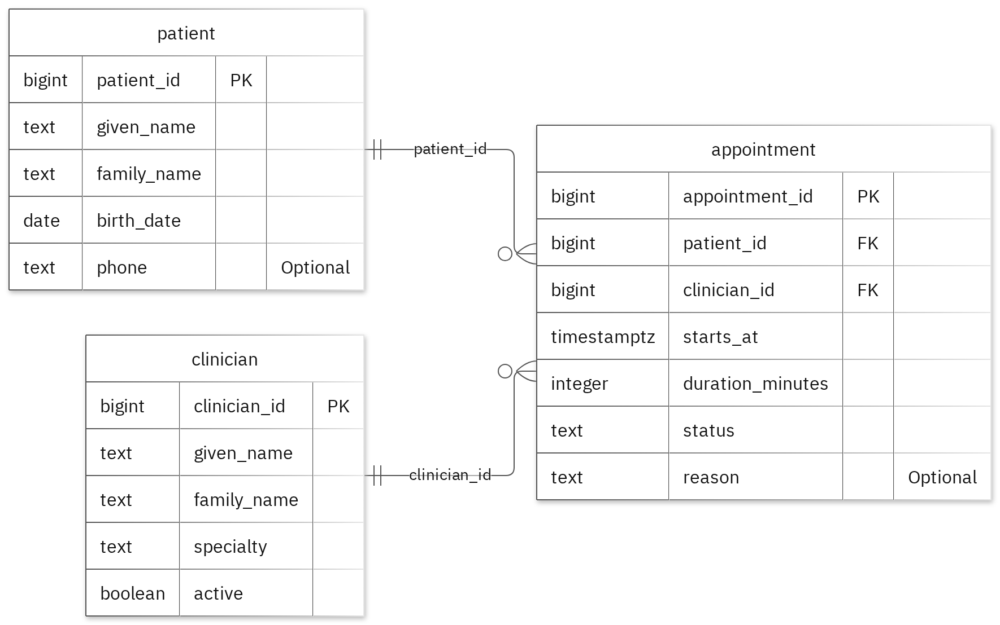

# MIT 8103 Advanced Database Systems

**Grapevine Hospital Management System** · Anyaegbu Chibuzor · Student ID 301913385

## Case study

My case study is the Grapevine Hospital Management System. The database supports scheduling staff, clinicians and hospital administrators, who need a reliable record of which patient is being seen, by which clinician and when. The design separates the core entities into 3 tables: patient, clinician and appointment. It supports the operations the case requires: registering patients and clinicians, booking and cancelling appointments, and reviewing clinician schedules and workloads. All patient and clinician records used in the exercises are simulated, so no real personal or health data was processed at any stage.

## Portfolio 1: Database Design and Modelling

Each table contains a primary key. The appointments table has foreign keys to ensure the appointment has a patient and clinician already registered in the system. Each table contains unique constraints to ensure there are no duplicates. The database has check constraints to ensure any business rules in the database are met. For example, the appointment duration must be more than 0 minutes. Normalisation examples have been used to show the sample data in 1NF, 2NF and 3NF. The 1NF ensures each field contains only one value. The 2NF removes partial dependencies so the patient and clinical information is only stored once. The 3NF removes transitive dependencies so any non-key attribute will depend on the key of the relevant table. This means if a clinician is updated it will only need to be changed once reducing any UPDATE, insert and delete anomalies.

Figure 1. Tables, keys and relationships. PK: primary key; FK: foreign key; UK: unique value.

<!-- PAGE BREAK -->

## Portfolio 2: Query Processing and Optimisation

3 SQL queries were run on the sample records. The JOIN query returned 1 row showing Avery has been matched with Jordan. This is what was expected.
20,000 rows were created for performance testing. The median time improved significantly from 1.059ms to 0.198ms. This is approximately 5.3x faster. The results were the same in both phases. The execution plan shows the query has used the new index. This is only applicable to this query and this environment. Using indexes adds more overhead to the database. They would be useful FOR frequently queried and specific searches.

## Portfolio 3: Transactions and Concurrency

A temporary counter was added to the appointments table to test out the COMMIT, ROLLBACK and READ COMMITTED. While the UPDATE was uncommitted in session A, the changes were not visible to session B. When rolled back, the previous committed value was shown.
Using no locks, both sessions saw the same value until committed. This caused one of the increments to overwrite the other resulting in the final value being 2 (lost UPDATE). Using SELECT … FOR UPDATE, session B would wait FOR session A to COMMIT. Once session A had committed, session B would see the updated value. The final value was 3. In a hospital scenario this could cause two administrators to book the same clinician. The counter was only added to complete the exercise. All fields in the case study remain the same.

## Portfolio 4: NoSQL and Advanced Data Models

A MongoDB collection was used called hospital_events. Two sample events were inserted. Four queries were run and returned the expected results. When trying to insert invalid data, the validation failed due to the invalid date type. Inserting a duplicate event ID also failed.
Snapshotting inserts related information into the event. This means the event can be viewed without needing to join any tables. The event shows what the information was at the time of the event. The details field can vary depending on the event type. This means new types can be added without changing the schema. However, the snapshot can become out of sync with the relational data. This means it is useful for historical data. The events are fictional so PostgreSQL still enforces relational rules.

## Repository and evidence

https://github.com/chibuzorHQ/Chibuzor_Anyaegbu_301913385

The portfolio folders contain the SQL and JavaScript, explanations, query plans, result tables and screenshots.

<!-- PAGE BREAK -->

## Portfolio 5: Distributed and Cloud Database Exercise

The option to discuss was chosen. A 3 node MongoDB replica set can be used. If the primary goes down, a majority vote will occur to SELECT a new primary. This means the replica set can tolerate 1 node failing. Any writes that have been acknowledged by a majority will be safe during failover. However, the secondary reads may be outdated due to lag.
Sharding the hospital_events would distribute the load. However, it does add complexity to the system. The shard key would need to be chosen well. At this scale a replica set is sufficient. Replication provides high availability but not recovery. If a document is deleted it will be replicated across the system. Backups are still needed. A plan for high availability would need to be put in place for PostgreSQL. No replica set was set up for live and no failover was tested.

## Personal reflection

Having separate tables for patient, clinicians and appointments means all information is stored in one place. Rules like ensuring the duration is more than 0 are enforced within the database. Any invalid data will be rejected.
The two session exercise demonstrated how easy it is to have a lost UPDATE. Both sessions see the same value. Locking the row before reading from it ensured both increments were kept. This would be done in the booking logic. The index comparison demonstrated the importance of looking at the execution plan. Even though the results were the same, the amount of work could be significantly different.

## AI-use declaration

GitHub Copilot was used to help create the database model, scripts and explanations. The generator ran the PostgreSQL and MongoDB exercises, ensuring the outputs were correct. The images of the results were captured. All outputs were reviewed by me.

## References

- [PostgreSQL: constraints](https://www.postgresql.org/docs/17/ddl-constraints.html)
- [PostgreSQL: EXPLAIN](https://www.postgresql.org/docs/17/using-explain.html)
- [PostgreSQL: isolation](https://www.postgresql.org/docs/17/transaction-iso.html)
- [PostgreSQL: row locks](https://www.postgresql.org/docs/17/explicit-locking.html)
- [MongoDB: data modelling](https://www.mongodb.com/docs/manual/data-modeling/)
- [MongoDB: replication](https://www.mongodb.com/docs/manual/replication/)
- [MongoDB: sharding](https://www.mongodb.com/docs/manual/sharding/)
- [Mermaid: ER diagrams](https://mermaid.js.org/syntax/entityRelationshipDiagram.html)

